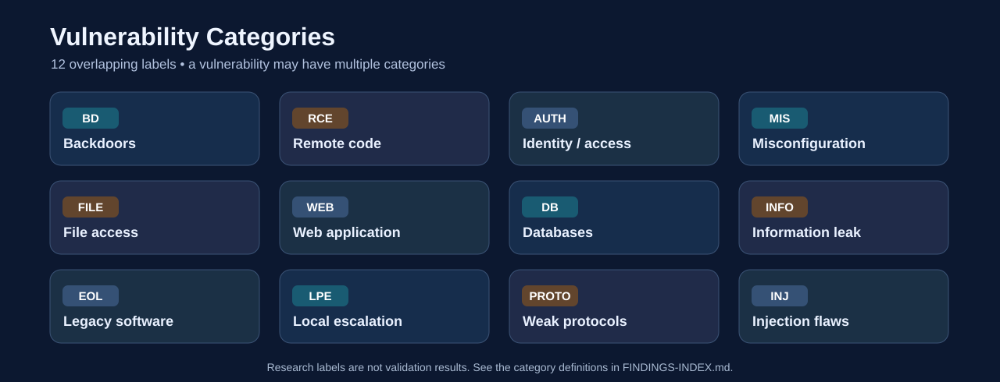

# Metasploitable 2 — Vulnerability Categories & Master Finding Index

> **Planning catalog, not a penetration test result.** These entries come from historical lab documentation and research. **No vulnerabilities have been tested or confirmed on the maintainer's local VM yet.** In this repository, `NET-###`, `DVWA-###`, and `MUT-###` are **catalog IDs**. Only `VULN-###` identifies an individual case-study report.

## 1. Vulnerability categories — what each category means

A finding can belong to **more than one category**. Example: vsftpd backdoor = `BD` + `RCE`; MySQL blank root password = `AUTH` + `DB` + `MIS`; Mutillidae SQL injection = `WEB` + `INJ` + `DB`.

| Code | Category | Meaning | Candidates tagged* |
| --- | --- | --- | ---: |
| `BD` | **Backdoors** | Hidden or deliberately exposed access paths that bypass normal security controls. | 3 |
| `RCE` | **Remote Code Execution** | A remote user can cause the target to run operating-system or application commands. | 13 |
| `AUTH` | **Authentication & access control** | Weak credentials, login bypasses, authorization failures, or excessive privileges. | 38 |
| `MIS` | **Security misconfiguration** | Unsafe default settings, unintended service exposure, insecure trust or permissions. | 37 |
| `FILE` | **File access & sharing** | Unsafe shares, uploads, traversal, local/remote file inclusion, or filesystem access. | 13 |
| `WEB` | **Web application security** | Weaknesses in HTTP applications, web input handling, sessions, and request processing. | 52 |
| `DB` | **Database security** | Weak database authentication, unsafe database access, or injection affecting stored data. | 13 |
| `INFO` | **Information disclosure** | Exposure of protected data, internal configuration, user information, or environment details. | 10 |
| `EOL` | **Legacy & outdated components** | Unsupported systems or old software requiring patch/version-specific review; version age alone is not proof. | 7 |
| `LPE` | **Local privilege escalation** | A user with some local access may gain higher permissions on the host. | 2 |
| `PROTO` | **Protocol & cryptographic weakness** | Cleartext credentials, legacy protocols, weak encryption, or predictable key material. | 10 |
| `INJ` | **Injection flaws** | Untrusted input changes the meaning of SQL, OS commands, JavaScript, HTML, CSS, or another interpreter. | 26 |

*Category counts overlap and **do not add up to 89** because items have multiple tags.*

## 2. How to interpret this catalog

| Field | Meaning |
| --- | --- |
| **Catalog ID** | Research/planning row, **not** a confirmed finding ID |
| **CVE reference** | A published CVE associated with this candidate; `N/A` means no unique CVE is assigned or verified |
| **Categories** | One or more tags from the definitions above |
| **Research basis** | `Documented` = Rapid7 or historical source describes scenario; `Config-dependent`/`Research check` = verify install/configuration; `Version review` = age alone is not exploitable proof; `Application exercise` = training-module type |
| **Local status** | Actual test status of **this repository's VM**, initially **Not tested** for every row |
| **Case study** | Link to a dedicated `VULN-###` folder **only when that exercise is started** |

**Status lifecycle:** `Not tested` → `Investigating` → `Confirmed` / `Not confirmed` / `Unable to validate`. A confirmed issue must include evidence. Severity is intentionally omitted from the catalog until individual findings have an assessed impact and a documented scoring rationale.

**CVE vs CWE:** CVE identifies a specific published software vulnerability; CWE describes a **type** of software weakness. For cases like weak credentials, XSS in deliberately vulnerable training applications, and misconfiguration, use an applicable CWE in the individual case study **without inventing a CVE**. Useful official links: [CWE-79 XSS](https://cwe.mitre.org/data/definitions/79.html), [CWE-89 SQL Injection](https://cwe.mitre.org/data/definitions/89.html), [CWE-78 OS Command Injection](https://cwe.mitre.org/data/definitions/78.html), [CWE-352 CSRF](https://cwe.mitre.org/data/definitions/352.html), [CWE-200 Information Exposure](https://cwe.mitre.org/data/definitions/200.html), [CWE-287 Improper Authentication](https://cwe.mitre.org/data/definitions/287.html), [CWE-22 Path Traversal](https://cwe.mitre.org/data/definitions/22.html).

## 3. Master finding index — all researched candidates

**Research catalog:** 48 network/service/system scenarios + 9 DVWA exercises + 32 Mutillidae scenarios = **89 catalog entries**. This is **not** an official count of unique vulnerabilities and may include related or overlapping issues, configuration checks, and application exercise variants.

### 3A. Network, services, host and configuration (48)

| Catalog ID | Candidate / scenario | Service / location | CVE reference | Categories | Research basis | Local status | Case study |
| --- | --- | --- | --- | --- | --- | --- | --- |
| **NET-001** | vsftpd 2.3.4 backdoor | FTP / 21 | [CVE-2011-2523](https://nvd.nist.gov/vuln/detail/CVE-2011-2523) | `BD` `RCE` | Documented | Not tested | [VULN-001](vulnerabilities/VULN-001-vsftpd-backdoor/README.md) |
| **NET-002** | UnrealIRCd 3.2.8.1 backdoor | IRC / 6667 | [CVE-2010-2075](https://nvd.nist.gov/vuln/detail/CVE-2010-2075) | `BD` `RCE` | Documented | Not tested | — |
| **NET-003** | Ingreslock root bind shell | TCP / 1524 | N/A — see CWE after validation | `BD` `RCE` `AUTH` | Documented | Not tested | — |
| **NET-004** | DistCC remote command execution | DistCC / 3632 | [CVE-2004-2687](https://nvd.nist.gov/vuln/detail/CVE-2004-2687) | `RCE` `MIS` | Documented | Not tested | — |
| **NET-005** | Samba username-map script command injection | SMB / 139,445 | [CVE-2007-2447](https://nvd.nist.gov/vuln/detail/CVE-2007-2447) | `RCE` `INJ` `MIS` | Config-dependent | Not tested | — |
| **NET-006** | Java RMI insecure remote execution candidate | RMI / 1099 | N/A — see CWE after validation | `RCE` `MIS` | Config-dependent | Not tested | — |
| **NET-007** | Ruby DRb exposed remote object execution candidate | DRb / 8787 | N/A — see CWE after validation | `RCE` `MIS` | Config-dependent | Not tested | — |
| **NET-008** | Legacy wiki command-injection candidate (identify product first) | HTTP / 80 | N/A — see CWE after validation | `RCE` `WEB` `INJ` `EOL` | Research check | Not tested | — |
| **NET-009** | PHP-CGI argument injection (only if CGI mode is used) | HTTP / 80 | [CVE-2012-1823](https://nvd.nist.gov/vuln/detail/CVE-2012-1823) | `RCE` `WEB` `INJ` | Config-dependent | Not tested | — |
| **NET-010** | Tomcat Manager authenticated WAR deployment | Tomcat / 8180 | N/A — see CWE after validation | `AUTH` `WEB` `RCE` `MIS` | Config-dependent | Not tested | — |
| **NET-011** | ProFTPD mod_sql SQL injection (if mod_sql enabled) | FTP / 2121 | [CVE-2009-0542](https://nvd.nist.gov/vuln/detail/CVE-2009-0542) | `INJ` `DB` `AUTH` | Config-dependent | Not tested | — |
| **NET-012** | Default SSH credentials | SSH / 22 | N/A — see CWE after validation | `AUTH` `MIS` | Documented | Not tested | — |
| **NET-013** | Additional weak local account passwords | Linux accounts | N/A — see CWE after validation | `AUTH` `MIS` | Documented | Not tested | — |
| **NET-014** | Default/weak Telnet credentials | Telnet / 23 | N/A — see CWE after validation | `AUTH` `PROTO` | Research check | Not tested | — |
| **NET-015** | Trust-based Rexec access | Rexec / 512 | N/A — see CWE after validation | `AUTH` `MIS` `PROTO` | Documented | Not tested | — |
| **NET-016** | Trust-based Rlogin access | Rlogin / 513 | N/A — see CWE after validation | `AUTH` `MIS` `PROTO` | Documented | Not tested | — |
| **NET-017** | Trust-based Rsh access | Rsh / 514 | N/A — see CWE after validation | `AUTH` `MIS` `PROTO` | Documented | Not tested | — |
| **NET-018** | MySQL root access with empty password | MySQL / 3306 | N/A — see CWE after validation | `DB` `AUTH` `MIS` | Documented | Not tested | — |
| **NET-019** | PostgreSQL default credentials | PostgreSQL / 5432 | N/A — see CWE after validation | `DB` `AUTH` `MIS` | Documented | Not tested | — |
| **NET-020** | Weak/default VNC password | VNC / 5900 | N/A — see CWE after validation | `AUTH` `MIS` `PROTO` | Documented | Not tested | — |
| **NET-021** | Tomcat Manager weak/default credentials | Tomcat / 8180 | N/A — see CWE after validation | `AUTH` `WEB` `MIS` | Documented | Not tested | — |
| **NET-022** | Predictable Debian/Ubuntu-generated SSH keys (if present) | SSH / 22 | [CVE-2008-0166](https://nvd.nist.gov/vuln/detail/CVE-2008-0166) | `AUTH` `PROTO` | Config-dependent | Not tested | — |
| **NET-023** | Anonymous FTP login | FTP / 21 | N/A — see CWE after validation | `AUTH` `FILE` `MIS` | Research check | Not tested | — |
| **NET-024** | Anonymous ProFTPD access | FTP / 2121 | N/A — see CWE after validation | `AUTH` `FILE` `MIS` | Config-dependent | Not tested | — |
| **NET-025** | Anonymous SMB shares | SMB / 139,445 | N/A — see CWE after validation | `FILE` `AUTH` `MIS` | Documented | Not tested | — |
| **NET-026** | Samba symlink traversal / wide links | SMB / 139,445 | N/A — see CWE after validation | `FILE` `MIS` `AUTH` | Documented | Not tested | — |
| **NET-027** | NFS export of root filesystem to all clients | NFS / 2049 | N/A — see CWE after validation | `FILE` `MIS` `AUTH` | Documented | Not tested | — |
| **NET-028** | Writable NFS export | NFS / 2049 | N/A — see CWE after validation | `FILE` `MIS` `AUTH` | Documented | Not tested | — |
| **NET-029** | WebDAV unrestricted PUT/upload | WebDAV / 80 | N/A — see CWE after validation | `FILE` `WEB` `MIS` | Config-dependent | Not tested | — |
| **NET-030** | Unauthenticated X11 display access | X11 / 6000 | N/A — see CWE after validation | `AUTH` `MIS` `INFO` | Config-dependent | Not tested | — |
| **NET-031** | SMTP user enumeration | SMTP / 25 | N/A — see CWE after validation | `INFO` `MIS` | Config-dependent | Not tested | — |
| **NET-032** | SMTP open relay | SMTP / 25 | N/A — see CWE after validation | `MIS` `AUTH` | Config-dependent | Not tested | — |
| **NET-033** | DNS zone transfer | DNS / 53 | N/A — see CWE after validation | `INFO` `MIS` | Config-dependent | Not tested | — |
| **NET-034** | Exposed AJP connector | AJP / 8009 | N/A — see CWE after validation | `MIS` `WEB` | Config-dependent | Not tested | — |
| **NET-035** | Excessive RPC service disclosure | RPC / 111 | N/A — see CWE after validation | `INFO` `MIS` | Research check | Not tested | — |
| **NET-036** | PHP configuration disclosure | HTTP / 80 | N/A — see CWE after validation | `INFO` `WEB` `MIS` | Documented | Not tested | — |
| **NET-037** | Exposed phpMyAdmin interface | HTTP / 80 | N/A — see CWE after validation | `WEB` `DB` `AUTH` `MIS` | Documented | Not tested | — |
| **NET-038** | Cleartext FTP authentication | FTP / 21,2121 | N/A — see CWE after validation | `PROTO` `AUTH` | Protocol-level | Not tested | — |
| **NET-039** | Cleartext Telnet authentication | Telnet / 23 | N/A — see CWE after validation | `PROTO` `AUTH` | Protocol-level | Not tested | — |
| **NET-040** | Legacy SMB protocol/security configurations | SMB / 139,445 | N/A — see CWE after validation | `PROTO` `EOL` `MIS` | Config-dependent | Not tested | — |
| **NET-041** | Outdated Apache HTTP Server 2.2.8 | HTTP / 80 | N/A — see CWE after validation | `EOL` `WEB` | Version review | Not tested | — |
| **NET-042** | Outdated Apache Tomcat 5.5 | Tomcat / 8180 | N/A — see CWE after validation | `EOL` `WEB` | Version review | Not tested | — |
| **NET-043** | Outdated PHP 5.2.x | Web stack | N/A — see CWE after validation | `EOL` `WEB` | Version review | Not tested | — |
| **NET-044** | Unsupported Ubuntu 8.04 | Operating system | N/A — see CWE after validation | `EOL` `MIS` | Version review | Not tested | — |
| **NET-045** | Historical kernel local privilege-escalation candidates | Linux kernel | N/A — see CWE after validation | `LPE` `EOL` | Version review | Not tested | — |
| **NET-046** | Unsafe privileged SUID executable configuration | Local filesystem | N/A — see CWE after validation | `LPE` `MIS` `FILE` | Config-dependent | Not tested | — |
| **NET-047** | Missing browser security headers | HTTP / 80 | N/A — see CWE after validation | `WEB` `MIS` | Config-dependent | Not tested | — |
| **NET-048** | Weak TLS/SSL configurations (if a TLS service is running) | TLS services | N/A — see CWE after validation | `PROTO` `MIS` | Config-dependent | Not tested | — |

### 3B. DVWA — web application modules (9)

| Catalog ID | Candidate / scenario | Service / location | CVE reference | Categories | Research basis | Local status | Case study |
| --- | --- | --- | --- | --- | --- | --- | --- |
| **DVWA-001** | Brute force / weak login protection | Login | N/A — see CWE after validation | `WEB` `AUTH` | Application exercise | Not tested | — |
| **DVWA-002** | OS command injection | Command execution | N/A — see CWE after validation | `WEB` `INJ` `RCE` | Application exercise | Not tested | — |
| **DVWA-003** | Cross-Site Request Forgery (CSRF) | CSRF | N/A — see CWE after validation | `WEB` `AUTH` | Application exercise | Not tested | — |
| **DVWA-004** | Local/remote file inclusion | File inclusion | N/A — see CWE after validation | `WEB` `FILE` | Application exercise | Not tested | — |
| **DVWA-005** | SQL injection | SQL injection | N/A — see CWE after validation | `WEB` `INJ` `DB` | Application exercise | Not tested | — |
| **DVWA-006** | Blind SQL injection | Blind SQL injection | N/A — see CWE after validation | `WEB` `INJ` `DB` | Application exercise | Not tested | — |
| **DVWA-007** | Unrestricted file upload | File upload | N/A — see CWE after validation | `WEB` `FILE` `RCE` | Application exercise | Not tested | — |
| **DVWA-008** | Reflected cross-site scripting | Reflected XSS | N/A — see CWE after validation | `WEB` `INJ` | Application exercise | Not tested | — |
| **DVWA-009** | Stored cross-site scripting | Stored XSS | N/A — see CWE after validation | `WEB` `INJ` | Application exercise | Not tested | — |

### 3C. Mutillidae — web vulnerability scenarios (32)

| Catalog ID | Candidate / scenario | Service / location | CVE reference | Categories | Research basis | Local status | Case study |
| --- | --- | --- | --- | --- | --- | --- | --- |
| **MUT-001** | Blog-entry SQL injection | add-to-your-blog.php | N/A — see CWE after validation | `WEB` `INJ` `DB` | Documented | Not tested | — |
| **MUT-002** | Login SQL injection / authentication bypass | login.php | N/A — see CWE after validation | `WEB` `INJ` `DB` `AUTH` | Documented | Not tested | — |
| **MUT-003** | Registration SQL injection | register.php | N/A — see CWE after validation | `WEB` `INJ` `DB` | Documented | Not tested | — |
| **MUT-004** | User-info SQL injection | user-info.php | N/A — see CWE after validation | `WEB` `INJ` `DB` `INFO` | Documented | Not tested | — |
| **MUT-005** | UID-cookie SQL injection | index.php | N/A — see CWE after validation | `WEB` `INJ` `DB` | Documented | Not tested | — |
| **MUT-006** | SQL injection via logged HTTP headers | log-visit.php | N/A — see CWE after validation | `WEB` `INJ` `DB` | Documented | Not tested | — |
| **MUT-007** | Reflected XSS in login fields | login.php | N/A — see CWE after validation | `WEB` `INJ` | Documented | Not tested | — |
| **MUT-008** | Stored XSS in blog entries | add-to-your-blog.php | N/A — see CWE after validation | `WEB` `INJ` | Documented | Not tested | — |
| **MUT-009** | Header-based XSS (User-Agent / Referer) | browser-info.php | N/A — see CWE after validation | `WEB` `INJ` | Documented | Not tested | — |
| **MUT-010** | XSS from displayed log entries | show-log.php | N/A — see CWE after validation | `WEB` `INJ` | Documented | Not tested | — |
| **MUT-011** | XSS through GET/POST/cookies | captured-data.php | N/A — see CWE after validation | `WEB` `INJ` | Documented | Not tested | — |
| **MUT-012** | DOM injection via HTML5 storage | html5-storage.php | N/A — see CWE after validation | `WEB` `INJ` | Documented | Not tested | — |
| **MUT-013** | OS command injection | dns-lookup.php | N/A — see CWE after validation | `WEB` `INJ` `RCE` | Documented | Not tested | — |
| **MUT-014** | Arbitrary file inclusion | arbitrary-file-inclusion.php | N/A — see CWE after validation | `WEB` `FILE` | Documented | Not tested | — |
| **MUT-015** | Arbitrary file read / path traversal | source-viewer.php | N/A — see CWE after validation | `WEB` `FILE` `INFO` | Documented | Not tested | — |
| **MUT-016** | Local/remote file or URL loading | text-file-viewer.php | N/A — see CWE after validation | `WEB` `FILE` `INFO` | Documented | Not tested | — |
| **MUT-017** | Privilege manipulation through UID cookie | index.php | N/A — see CWE after validation | `WEB` `AUTH` | Documented | Not tested | — |
| **MUT-018** | CSRF in blog functionality | add-to-your-blog.php | N/A — see CWE after validation | `WEB` `AUTH` | Documented | Not tested | — |
| **MUT-019** | CSRF in polling | user-poll.php | N/A — see CWE after validation | `WEB` `AUTH` | Documented | Not tested | — |
| **MUT-020** | Clickjacking via framed content | framing.php | N/A — see CWE after validation | `WEB` `AUTH` | Documented | Not tested | — |
| **MUT-021** | Clickjacking in art page | rene-magritte.php | N/A — see CWE after validation | `WEB` `AUTH` | Documented | Not tested | — |
| **MUT-022** | Open redirect on credits | credits.php | N/A — see CWE after validation | `WEB` `AUTH` | Documented | Not tested | — |
| **MUT-023** | Open redirect in redirect/logger | redirectandlog.php | N/A — see CWE after validation | `WEB` `AUTH` | Documented | Not tested | — |
| **MUT-024** | HTTP response splitting | index.php | N/A — see CWE after validation | `WEB` `INJ` | Documented | Not tested | — |
| **MUT-025** | HTTP parameter pollution | user-poll.php | N/A — see CWE after validation | `WEB` `INJ` | Documented | Not tested | — |
| **MUT-026** | HTTP method validation bypass | user-poll.php | N/A — see CWE after validation | `WEB` `AUTH` | Documented | Not tested | — |
| **MUT-027** | Client-side JavaScript validation bypass | login.php | N/A — see CWE after validation | `WEB` `AUTH` | Documented | Not tested | — |
| **MUT-028** | Cookies missing HttpOnly | process-commands.php | N/A — see CWE after validation | `WEB` `MIS` `AUTH` | Documented | Not tested | — |
| **MUT-029** | Unencrypted database credentials in config | config.inc | N/A — see CWE after validation | `INFO` `DB` `MIS` | Documented | Not tested | — |
| **MUT-030** | PHP configuration and path disclosure | phpinfo.php | N/A — see CWE after validation | `INFO` `WEB` `MIS` | Documented | Not tested | — |
| **MUT-031** | CSS injection | set-background-color.php | N/A — see CWE after validation | `WEB` `INJ` | Documented | Not tested | — |
| **MUT-032** | JSON injection | pen-test-tool-lookup.php | N/A — see CWE after validation | `WEB` `INJ` | Documented | Not tested | — |

## 4. Browse entries by category

Expand any category to jump to candidate IDs. **Multiple categories can include the same ID.**

<strong>BD — Backdoors</strong> (3 catalog entries)

- [NET-001](#net-001): vsftpd 2.3.4 backdoor
- [NET-002](#net-002): UnrealIRCd 3.2.8.1 backdoor
- [NET-003](#net-003): Ingreslock root bind shell

<strong>RCE — Remote Code Execution</strong> (13 catalog entries)

- [NET-001](#net-001): vsftpd 2.3.4 backdoor
- [NET-002](#net-002): UnrealIRCd 3.2.8.1 backdoor
- [NET-003](#net-003): Ingreslock root bind shell
- [NET-004](#net-004): DistCC remote command execution
- [NET-005](#net-005): Samba username-map script command injection
- [NET-006](#net-006): Java RMI insecure remote execution candidate
- [NET-007](#net-007): Ruby DRb exposed remote object execution candidate
- [NET-008](#net-008): Legacy wiki command-injection candidate (identify product first)
- [NET-009](#net-009): PHP-CGI argument injection (only if CGI mode is used)
- [NET-010](#net-010): Tomcat Manager authenticated WAR deployment
- [DVWA-002](#dvwa-002): OS command injection
- [DVWA-007](#dvwa-007): Unrestricted file upload
- [MUT-013](#mut-013): OS command injection

<strong>AUTH — Authentication & access control</strong> (38 catalog entries)

- [NET-003](#net-003): Ingreslock root bind shell
- [NET-010](#net-010): Tomcat Manager authenticated WAR deployment
- [NET-011](#net-011): ProFTPD mod_sql SQL injection (if mod_sql enabled)
- [NET-012](#net-012): Default SSH credentials
- [NET-013](#net-013): Additional weak local account passwords
- [NET-014](#net-014): Default/weak Telnet credentials
- [NET-015](#net-015): Trust-based Rexec access
- [NET-016](#net-016): Trust-based Rlogin access
- [NET-017](#net-017): Trust-based Rsh access
- [NET-018](#net-018): MySQL root access with empty password
- [NET-019](#net-019): PostgreSQL default credentials
- [NET-020](#net-020): Weak/default VNC password
- [NET-021](#net-021): Tomcat Manager weak/default credentials
- [NET-022](#net-022): Predictable Debian/Ubuntu-generated SSH keys (if present)
- [NET-023](#net-023): Anonymous FTP login
- [NET-024](#net-024): Anonymous ProFTPD access
- [NET-025](#net-025): Anonymous SMB shares
- [NET-026](#net-026): Samba symlink traversal / wide links
- [NET-027](#net-027): NFS export of root filesystem to all clients
- [NET-028](#net-028): Writable NFS export
- [NET-030](#net-030): Unauthenticated X11 display access
- [NET-032](#net-032): SMTP open relay
- [NET-037](#net-037): Exposed phpMyAdmin interface
- [NET-038](#net-038): Cleartext FTP authentication
- [NET-039](#net-039): Cleartext Telnet authentication
- [DVWA-001](#dvwa-001): Brute force / weak login protection
- [DVWA-003](#dvwa-003): Cross-Site Request Forgery (CSRF)
- [MUT-002](#mut-002): Login SQL injection / authentication bypass
- [MUT-017](#mut-017): Privilege manipulation through UID cookie
- [MUT-018](#mut-018): CSRF in blog functionality
- [MUT-019](#mut-019): CSRF in polling
- [MUT-020](#mut-020): Clickjacking via framed content
- [MUT-021](#mut-021): Clickjacking in art page
- [MUT-022](#mut-022): Open redirect on credits
- [MUT-023](#mut-023): Open redirect in redirect/logger
- [MUT-026](#mut-026): HTTP method validation bypass
- [MUT-027](#mut-027): Client-side JavaScript validation bypass
- [MUT-028](#mut-028): Cookies missing HttpOnly

<strong>MIS — Security misconfiguration</strong> (37 catalog entries)

- [NET-004](#net-004): DistCC remote command execution
- [NET-005](#net-005): Samba username-map script command injection
- [NET-006](#net-006): Java RMI insecure remote execution candidate
- [NET-007](#net-007): Ruby DRb exposed remote object execution candidate
- [NET-010](#net-010): Tomcat Manager authenticated WAR deployment
- [NET-012](#net-012): Default SSH credentials
- [NET-013](#net-013): Additional weak local account passwords
- [NET-015](#net-015): Trust-based Rexec access
- [NET-016](#net-016): Trust-based Rlogin access
- [NET-017](#net-017): Trust-based Rsh access
- [NET-018](#net-018): MySQL root access with empty password
- [NET-019](#net-019): PostgreSQL default credentials
- [NET-020](#net-020): Weak/default VNC password
- [NET-021](#net-021): Tomcat Manager weak/default credentials
- [NET-023](#net-023): Anonymous FTP login
- [NET-024](#net-024): Anonymous ProFTPD access
- [NET-025](#net-025): Anonymous SMB shares
- [NET-026](#net-026): Samba symlink traversal / wide links
- [NET-027](#net-027): NFS export of root filesystem to all clients
- [NET-028](#net-028): Writable NFS export
- [NET-029](#net-029): WebDAV unrestricted PUT/upload
- [NET-030](#net-030): Unauthenticated X11 display access
- [NET-031](#net-031): SMTP user enumeration
- [NET-032](#net-032): SMTP open relay
- [NET-033](#net-033): DNS zone transfer
- [NET-034](#net-034): Exposed AJP connector
- [NET-035](#net-035): Excessive RPC service disclosure
- [NET-036](#net-036): PHP configuration disclosure
- [NET-037](#net-037): Exposed phpMyAdmin interface
- [NET-040](#net-040): Legacy SMB protocol/security configurations
- [NET-044](#net-044): Unsupported Ubuntu 8.04
- [NET-046](#net-046): Unsafe privileged SUID executable configuration
- [NET-047](#net-047): Missing browser security headers
- [NET-048](#net-048): Weak TLS/SSL configurations (if a TLS service is running)
- [MUT-028](#mut-028): Cookies missing HttpOnly
- [MUT-029](#mut-029): Unencrypted database credentials in config
- [MUT-030](#mut-030): PHP configuration and path disclosure

<strong>FILE — File access & sharing</strong> (13 catalog entries)

- [NET-023](#net-023): Anonymous FTP login
- [NET-024](#net-024): Anonymous ProFTPD access
- [NET-025](#net-025): Anonymous SMB shares
- [NET-026](#net-026): Samba symlink traversal / wide links
- [NET-027](#net-027): NFS export of root filesystem to all clients
- [NET-028](#net-028): Writable NFS export
- [NET-029](#net-029): WebDAV unrestricted PUT/upload
- [NET-046](#net-046): Unsafe privileged SUID executable configuration
- [DVWA-004](#dvwa-004): Local/remote file inclusion
- [DVWA-007](#dvwa-007): Unrestricted file upload
- [MUT-014](#mut-014): Arbitrary file inclusion
- [MUT-015](#mut-015): Arbitrary file read / path traversal
- [MUT-016](#mut-016): Local/remote file or URL loading

<strong>WEB — Web application security</strong> (52 catalog entries)

- [NET-008](#net-008): Legacy wiki command-injection candidate (identify product first)
- [NET-009](#net-009): PHP-CGI argument injection (only if CGI mode is used)
- [NET-010](#net-010): Tomcat Manager authenticated WAR deployment
- [NET-021](#net-021): Tomcat Manager weak/default credentials
- [NET-029](#net-029): WebDAV unrestricted PUT/upload
- [NET-034](#net-034): Exposed AJP connector
- [NET-036](#net-036): PHP configuration disclosure
- [NET-037](#net-037): Exposed phpMyAdmin interface
- [NET-041](#net-041): Outdated Apache HTTP Server 2.2.8
- [NET-042](#net-042): Outdated Apache Tomcat 5.5
- [NET-043](#net-043): Outdated PHP 5.2.x
- [NET-047](#net-047): Missing browser security headers
- [DVWA-001](#dvwa-001): Brute force / weak login protection
- [DVWA-002](#dvwa-002): OS command injection
- [DVWA-003](#dvwa-003): Cross-Site Request Forgery (CSRF)
- [DVWA-004](#dvwa-004): Local/remote file inclusion
- [DVWA-005](#dvwa-005): SQL injection
- [DVWA-006](#dvwa-006): Blind SQL injection
- [DVWA-007](#dvwa-007): Unrestricted file upload
- [DVWA-008](#dvwa-008): Reflected cross-site scripting
- [DVWA-009](#dvwa-009): Stored cross-site scripting
- [MUT-001](#mut-001): Blog-entry SQL injection
- [MUT-002](#mut-002): Login SQL injection / authentication bypass
- [MUT-003](#mut-003): Registration SQL injection
- [MUT-004](#mut-004): User-info SQL injection
- [MUT-005](#mut-005): UID-cookie SQL injection
- [MUT-006](#mut-006): SQL injection via logged HTTP headers
- [MUT-007](#mut-007): Reflected XSS in login fields
- [MUT-008](#mut-008): Stored XSS in blog entries
- [MUT-009](#mut-009): Header-based XSS (User-Agent / Referer)
- [MUT-010](#mut-010): XSS from displayed log entries
- [MUT-011](#mut-011): XSS through GET/POST/cookies
- [MUT-012](#mut-012): DOM injection via HTML5 storage
- [MUT-013](#mut-013): OS command injection
- [MUT-014](#mut-014): Arbitrary file inclusion
- [MUT-015](#mut-015): Arbitrary file read / path traversal
- [MUT-016](#mut-016): Local/remote file or URL loading
- [MUT-017](#mut-017): Privilege manipulation through UID cookie
- [MUT-018](#mut-018): CSRF in blog functionality
- [MUT-019](#mut-019): CSRF in polling
- [MUT-020](#mut-020): Clickjacking via framed content
- [MUT-021](#mut-021): Clickjacking in art page
- [MUT-022](#mut-022): Open redirect on credits
- [MUT-023](#mut-023): Open redirect in redirect/logger
- [MUT-024](#mut-024): HTTP response splitting
- [MUT-025](#mut-025): HTTP parameter pollution
- [MUT-026](#mut-026): HTTP method validation bypass
- [MUT-027](#mut-027): Client-side JavaScript validation bypass
- [MUT-028](#mut-028): Cookies missing HttpOnly
- [MUT-030](#mut-030): PHP configuration and path disclosure
- [MUT-031](#mut-031): CSS injection
- [MUT-032](#mut-032): JSON injection

<strong>DB — Database security</strong> (13 catalog entries)

- [NET-011](#net-011): ProFTPD mod_sql SQL injection (if mod_sql enabled)
- [NET-018](#net-018): MySQL root access with empty password
- [NET-019](#net-019): PostgreSQL default credentials
- [NET-037](#net-037): Exposed phpMyAdmin interface
- [DVWA-005](#dvwa-005): SQL injection
- [DVWA-006](#dvwa-006): Blind SQL injection
- [MUT-001](#mut-001): Blog-entry SQL injection
- [MUT-002](#mut-002): Login SQL injection / authentication bypass
- [MUT-003](#mut-003): Registration SQL injection
- [MUT-004](#mut-004): User-info SQL injection
- [MUT-005](#mut-005): UID-cookie SQL injection
- [MUT-006](#mut-006): SQL injection via logged HTTP headers
- [MUT-029](#mut-029): Unencrypted database credentials in config

<strong>INFO — Information disclosure</strong> (10 catalog entries)

- [NET-030](#net-030): Unauthenticated X11 display access
- [NET-031](#net-031): SMTP user enumeration
- [NET-033](#net-033): DNS zone transfer
- [NET-035](#net-035): Excessive RPC service disclosure
- [NET-036](#net-036): PHP configuration disclosure
- [MUT-004](#mut-004): User-info SQL injection
- [MUT-015](#mut-015): Arbitrary file read / path traversal
- [MUT-016](#mut-016): Local/remote file or URL loading
- [MUT-029](#mut-029): Unencrypted database credentials in config
- [MUT-030](#mut-030): PHP configuration and path disclosure

<strong>EOL — Legacy & outdated components</strong> (7 catalog entries)

- [NET-008](#net-008): Legacy wiki command-injection candidate (identify product first)
- [NET-040](#net-040): Legacy SMB protocol/security configurations
- [NET-041](#net-041): Outdated Apache HTTP Server 2.2.8
- [NET-042](#net-042): Outdated Apache Tomcat 5.5
- [NET-043](#net-043): Outdated PHP 5.2.x
- [NET-044](#net-044): Unsupported Ubuntu 8.04
- [NET-045](#net-045): Historical kernel local privilege-escalation candidates

<strong>LPE — Local privilege escalation</strong> (2 catalog entries)

- [NET-045](#net-045): Historical kernel local privilege-escalation candidates
- [NET-046](#net-046): Unsafe privileged SUID executable configuration

<strong>PROTO — Protocol & cryptographic weakness</strong> (10 catalog entries)

- [NET-014](#net-014): Default/weak Telnet credentials
- [NET-015](#net-015): Trust-based Rexec access
- [NET-016](#net-016): Trust-based Rlogin access
- [NET-017](#net-017): Trust-based Rsh access
- [NET-020](#net-020): Weak/default VNC password
- [NET-022](#net-022): Predictable Debian/Ubuntu-generated SSH keys (if present)
- [NET-038](#net-038): Cleartext FTP authentication
- [NET-039](#net-039): Cleartext Telnet authentication
- [NET-040](#net-040): Legacy SMB protocol/security configurations
- [NET-048](#net-048): Weak TLS/SSL configurations (if a TLS service is running)

<strong>INJ — Injection flaws</strong> (26 catalog entries)

- [NET-005](#net-005): Samba username-map script command injection
- [NET-008](#net-008): Legacy wiki command-injection candidate (identify product first)
- [NET-009](#net-009): PHP-CGI argument injection (only if CGI mode is used)
- [NET-011](#net-011): ProFTPD mod_sql SQL injection (if mod_sql enabled)
- [DVWA-002](#dvwa-002): OS command injection
- [DVWA-005](#dvwa-005): SQL injection
- [DVWA-006](#dvwa-006): Blind SQL injection
- [DVWA-008](#dvwa-008): Reflected cross-site scripting
- [DVWA-009](#dvwa-009): Stored cross-site scripting
- [MUT-001](#mut-001): Blog-entry SQL injection
- [MUT-002](#mut-002): Login SQL injection / authentication bypass
- [MUT-003](#mut-003): Registration SQL injection
- [MUT-004](#mut-004): User-info SQL injection
- [MUT-005](#mut-005): UID-cookie SQL injection
- [MUT-006](#mut-006): SQL injection via logged HTTP headers
- [MUT-007](#mut-007): Reflected XSS in login fields
- [MUT-008](#mut-008): Stored XSS in blog entries
- [MUT-009](#mut-009): Header-based XSS (User-Agent / Referer)
- [MUT-010](#mut-010): XSS from displayed log entries
- [MUT-011](#mut-011): XSS through GET/POST/cookies
- [MUT-012](#mut-012): DOM injection via HTML5 storage
- [MUT-013](#mut-013): OS command injection
- [MUT-024](#mut-024): HTTP response splitting
- [MUT-025](#mut-025): HTTP parameter pollution
- [MUT-031](#mut-031): CSS injection
- [MUT-032](#mut-032): JSON injection

## 5. Important research corrections and limitations

1. **TWiki and TikiWiki are different products.** The older discussion mentioned TWiki CVE-2005-2877 next to the bundled TikiWiki web directory. **Do not attribute CVE-2005-2877 to TikiWiki without establishing that the affected TWiki product is present.** NET-008 intentionally contains no CVE pending product identification. [NVD: CVE-2005-2877](https://nvd.nist.gov/vuln/detail/CVE-2005-2877).
2. **ProFTPD 1.3.1 and `mod_sql`**: CVE-2009-0542 applies to affected mod_sql configurations. It must be checked in the target, not assumed from a banner. The later ProFTPD 1.3.5 `mod_copy` issue is **not equivalent**. [Debian tracker](https://security-tracker.debian.org/tracker/CVE-2009-0542).
3. **PHP-CGI**: CVE-2012-1823 requires vulnerable CGI mode; a PHP version banner is insufficient. [CVE record](https://nvd.nist.gov/vuln/detail/CVE-2012-1823).
4. **SSH OpenSSL keys**: CVE-2008-0166 concerns key material generated using affected Debian/Ubuntu packages; the presence of SSH alone does not prove weak keys. [Ubuntu advisory](https://ubuntu.com/security/CVE-2008-0166).
5. **Version/port ≠ vulnerability**: Old software, anonymous access, SSL checks, AJP, RPC, and HTTP headers have distinct validation requirements. Duplicate observations should be merged into a single finding when they share the same root cause and remediation.
6. **Web apps may change**: DVWA/Mutillidae exercises are based on historical packaged versions. Check the actual page/module installed before creating an individual finding.
7. **Additional research opportunities**: phpMyAdmin, historical wiki installations, WebDAV, OS privilege-escalation paths, and more web endpoints can be added after verified enumeration. The catalog is comprehensive for the previous research discussion, not a guarantee that every flaw is enumerated.

## 6. Creating and linking an actual finding

1. Confirm scope and network safety from [SCOPE.md](SCOPE.md).
2. Identify a candidate from this index and confirm the service/application exists.
3. Copy [finding report template](templates/VULNERABILITY-README-TEMPLATE.md) into a new `vulnerabilities/VULN-###-short-name/` folder.
4. Add **catalog ID**, **CVE (if applicable)**, **CWE**, and **all matching category tags** at the start of its `README.md`.
5. Attach real scan output and numbered screenshots. Separate Metasploit from manual validation.
6. Update the candidate's **Local status**, add a **Case study** link in this index, and update the [main README](README.md) verified findings summary.
7. Include confirmed findings in the [final VAPT report](templates/FINAL-REPORT-TEMPLATE.md).

The existing first case study is [VULN-001 — vsftpd backdoor](vulnerabilities/VULN-001-vsftpd-backdoor/README.md), mapped to catalog ID **NET-001**, with status **Not tested**.

## 7. Primary references

- [Rapid7 — Metasploitable 2 Exploitability Guide](https://docs.rapid7.com/metasploit/metasploitable-2-exploitability-guide/)
- [Rapid7 — Metasploitable 2 overview](https://docs.rapid7.com/metasploit/metasploitable-2/)
- [OWASP Vulnerable Web Applications Directory — Metasploitable 2](https://vwad.owasp.org/app/metasploitable-2/)
- [NVD — National Vulnerability Database](https://nvd.nist.gov/)
- [CWE — Common Weakness Enumeration](https://cwe.mitre.org/)
- [Samba — CVE-2007-2447 advisory](https://www.samba.org/samba/security/CVE-2007-2447.html)

**Research scope:** Updated 2026-11-11. The local Metasploitable 2 VM has **not** been scanned or assessed for these 89 catalog items in this repository.
