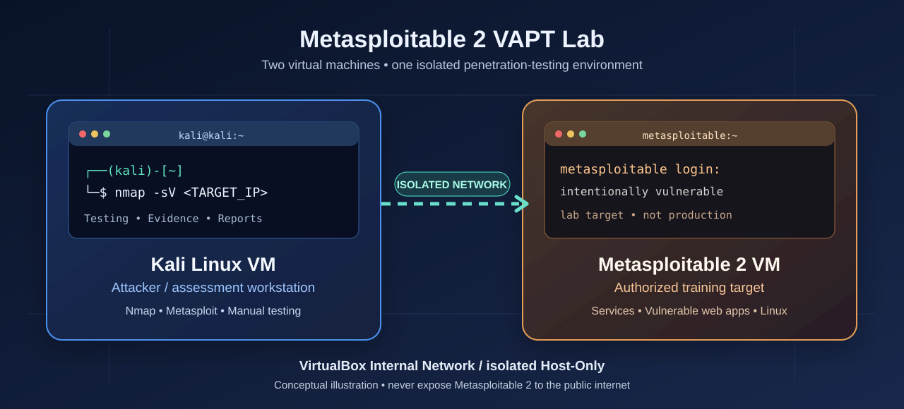

# Metasploitable 2 — VAPT Lab

**Kali Linux · Metasploitable 2 · Metasploit & manual testing · Professional VAPT reports**



This is my practical penetration-testing portfolio using a personally owned, **isolated Metasploitable 2 virtual machine**. Every researched scenario has its own report folder, where I will document enumeration, manual/Metasploit testing, screenshots, actual findings, and remediation.

> **Status:** **89 report folders prepared; 1 confirmed vulnerability (VULN-001).** Both **manual exploitation and Metasploit Meterpreter** confirmed root command execution on 28 November 2026; all other research scenarios remain unverified.

## Initial reconnaissance — 27 November 2026

**Full TCP scan complete:** **29 open ports**, **65,506 closed ports**, against `192.168.95.131` from Kali `192.168.95.128` using **Nmap 7.99** (`-sS -sV -sC -p- --open`).

| Open TCP ports | Detected services (selected) |
| --- | --- |
| `21`, `2121` | vsftpd 2.3.4, ProFTPD 1.3.1 |
| `22`, `23`, `25`, `53`, `80` | SSH, Telnet, SMTP, DNS, Apache HTTP |
| `139`, `445`, `2049` | Samba, NFS |
| `1524`, `3632`, `6667`, `6697` | Bind shell fingerprint, DistCC, UnrealIRCd |
| `3306`, `5432`, `5900` | MySQL, PostgreSQL, VNC |
| Remaining ports | See the complete 29-port table below |

<details>
<summary><strong>View all 29 open TCP ports and detected services</strong></summary>

| Port | Service | Reported software / identification |
| ---: | --- | --- |
| 21 | ftp | vsftpd 2.3.4 |
| 22 | ssh | OpenSSH 4.7p1 Debian 8ubuntu1 |
| 23 | telnet | Linux telnetd |
| 25 | smtp | Postfix smtpd |
| 53 | domain | ISC BIND 9.4.2 |
| 80 | http | Apache httpd 2.2.8 (Ubuntu) DAV/2 |
| 111 | rpcbind | RPCbind v2 |
| 139 | netbios-ssn | Samba smbd 3.X–4.X |
| 445 | netbios-ssn | Samba smbd 3.0.20-Debian |
| 512 | exec | netkit-rsh rexecd |
| 513 | login | rlogind (OpenBSD or Solaris fingerprint) |
| 514 | tcpwrapped | Service not identified |
| 1099 | java-rmi | GNU Classpath grmiregistry |
| 1524 | bindshell | Metasploitable root shell (Nmap identification) |
| 2049 | nfs | NFS v2–v4 |
| 2121 | ftp | ProFTPD 1.3.1 |
| 3306 | mysql | MySQL 5.0.51a-3ubuntu5 |
| 3632 | distccd | distccd v1 / GNU 4.2.4 |
| 5432 | postgresql | PostgreSQL 8.3.0–8.3.7 |
| 5900 | vnc | VNC protocol 3.3 |
| 6000 | X11 | X11 |
| 6667 | irc | UnrealIRCd |
| 6697 | irc | UnrealIRCd |
| 8180 | unknown | Unknown (Nmap could not identify) |
| 8787 | drb | Ruby DRb RMI (Ruby 1.8) |
| 40543 | status | RPC status v1 |
| 41662 | mountd | RPC mountd v1–v3 |
| 54420 | java-rmi | GNU Classpath grmiregistry |
| 57382 | nlockmgr | RPC nlockmgr v1–v4 |

</details>

**[Full reconnaissance report and all 29 ports](lab-setup/OPEN-PORTS.md)** · [First case study: VULN-001](vulnerabilities/network/VULN-001-vsftpd-backdoor/README.md)

**Screenshot:** Pending. Once the real Nmap terminal screenshot is added at `lab-setup/screenshots/01-all-open-ports.png`, it can be embedded here. No screenshot or exploit success has been fabricated.

> **Evidence boundary:** Scan confirms the vsftpd version and anonymous FTP access, **not** successful exploitation of the backdoor or other CVEs.


## Verified case study

**VULN-001 — vsftpd 2.3.4 backdoor:** Manual exploitation confirmed via Telnet (FTP trigger) and Netcat (TCP 6200), followed by a successful root Meterpreter session via Metasploit. The manual proof shows `uid=0(root)` and `whoami` → `root`; Metasploit returned `Server username: root`. [Read report and view genuine screenshots](vulnerabilities/network/VULN-001-vsftpd-backdoor/README.md).

## Start here

| Step | Open | What you will find |
| --- | --- | --- |
| 1 | [Lab setup](lab-setup/README.md) | Connect Kali and Metasploitable 2, run first Nmap scan |
| 2 | [Categories & finding index](FINDINGS-INDEX.md) | 12 category meanings, CVE references, 89 report links |
| 3 | [All vulnerability folders](vulnerabilities/README.md) | Browse network, DVWA, or Mutillidae folders |
| 4 | [Progress checklist](CHECKLIST.md) | What has really been tested |

## Repository structure

```text
metasploitable2-vapt-lab/
├── README.md
├── FINDINGS-INDEX.md             # Categories, CVEs and all 89 case links
├── CHECKLIST.md
├── SCOPE.md
├── assets/                       # Architecture and methodology diagrams
├── lab-setup/
│   ├── README.md                 # Setup, IPs and Nmap commands
│   └── scans/                    # Baseline scan results
├── vulnerabilities/
│   ├── README.md                 # Three report groups
│   ├── network/                  # VULN-001 to VULN-048 (48 cases)
│   ├── dvwa/                     # VULN-049 to VULN-057 (9 cases)
│   └── mutillidae/               # VULN-058 to VULN-089 (32 cases)
└── templates/                    # Reusable report templates
```

**Inside each of the 89 case folders:**

```text
VULN-###-short-name/
├── README.md                     # Full technical report template
├── scans/                        # Raw scan output (empty until tested)
└── screenshots/                  # Real supporting images (empty until tested)
```

The individual report covers **CVE/CWE, multi-category tags, enumeration, validation, Metasploit, manual testing, proof, impact, remediation, and references**.


Keep Metasploitable 2 disconnected from public networks and test only systems you own or are authorized to test. See [lab scope](SCOPE.md).

**References:** [Rapid7](https://docs.rapid7.com/metasploit/metasploitable-2-exploitability-guide/) · [NVD](https://nvd.nist.gov/) · [MITRE CWE](https://cwe.mitre.org/)

**Author:** [AazafRitha](https://github.com/AazafRitha)
