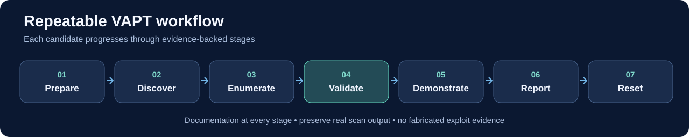

# Metasploitable 2 — VAPT Lab

**Kali Linux · Metasploitable 2 · Metasploit & manual testing · Professional VAPT reports**


This is my practical penetration-testing portfolio using a personally owned, **isolated Metasploitable 2 virtual machine**. Every researched scenario has its own report folder, where I will document enumeration, manual/Metasploit testing, screenshots, actual findings, and remediation.

> **Status:** **89 report folders prepared; 0 confirmed vulnerabilities documented.** The research catalog is not proof of vulnerability.

## Start here

| Step | Open | What you will find |
| --- | --- | --- |
| 1 | [Lab setup](lab-setup/README.md) | Connect Kali and Metasploitable 2, run first Nmap scan |
| 2 | [Categories & finding index](FINDINGS-INDEX.md) | 12 category meanings, CVE references, 89 report links |
| 3 | [All vulnerability folders](vulnerabilities/README.md) | Browse network, DVWA, or Mutillidae folders |
| 4 | [Progress checklist](CHECKLIST.md) | What has really been tested |

## Repository structure

```text
metasploitable2-vapt-lab/
├── README.md
├── FINDINGS-INDEX.md             # Categories, CVEs and all 89 case links
├── CHECKLIST.md
├── SCOPE.md
├── assets/                       # Architecture and methodology diagrams
├── lab-setup/
│   ├── README.md                 # Setup, IPs and Nmap commands
│   └── scans/                    # Baseline scan results
├── vulnerabilities/
│   ├── README.md                 # Three report groups
│   ├── network/                  # VULN-001 to VULN-048 (48 cases)
│   ├── dvwa/                     # VULN-049 to VULN-057 (9 cases)
│   └── mutillidae/               # VULN-058 to VULN-089 (32 cases)
└── templates/                    # Reusable report templates
```

**Inside each of the 89 case folders:**

```text
VULN-###-short-name/
├── README.md                     # Full technical report template
├── scans/                        # Raw scan output (empty until tested)
└── screenshots/                  # Real supporting images (empty until tested)
```

The individual report covers **CVE/CWE, multi-category tags, enumeration, validation, Metasploit, manual testing, proof, impact, remediation, and references**.



Keep Metasploitable 2 disconnected from public networks and test only systems you own or are authorized to test. See [lab scope](SCOPE.md).

**References:** [Rapid7](https://docs.rapid7.com/metasploit/metasploitable-2-exploitability-guide/) · [NVD](https://nvd.nist.gov/) · [MITRE CWE](https://cwe.mitre.org/)

**Author:** [AazafRitha](https://github.com/AazafRitha)
