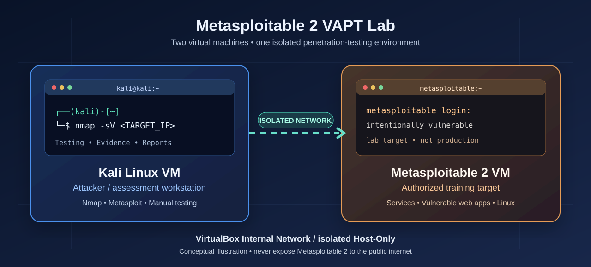
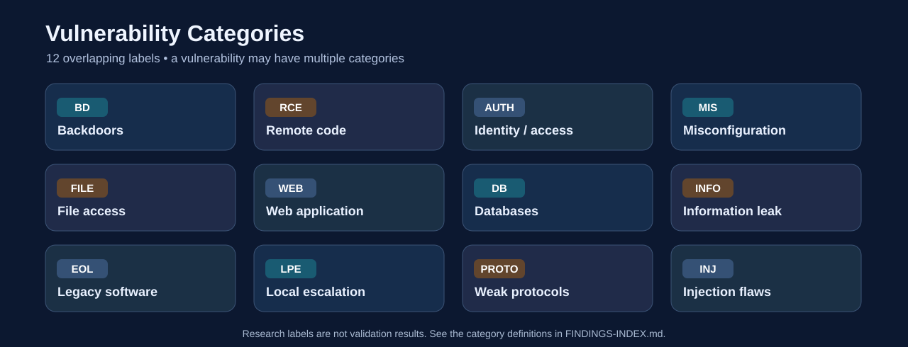
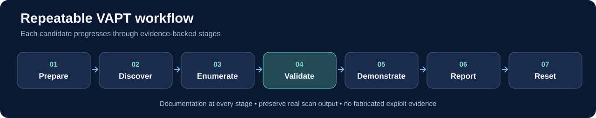

# Metasploitable 2 — Vulnerability Assessment & Penetration Testing Lab



> A structured, evidence-based **Vulnerability Assessment and Penetration Testing (VAPT)** portfolio project using **Kali Linux**, **Metasploitable 2**, **Nmap**, **Metasploit Framework**, and **manual exploitation** in a private VirtualBox training environment.

[](https://github.com/AazafRitha/metasploitable2-vapt-lab)


**Maintainer:** [AazafRitha](https://github.com/AazafRitha)  
**Target:** Metasploitable 2 — intentionally vulnerable training VM  
**Attacker:** Kali Linux VM  
**Platform:** VirtualBox isolated Internal Network / carefully isolated Host-Only Network  
**Assessment status:** No locally verified vulnerabilities documented yet

> [!IMPORTANT]
> This project is for **authorized testing of the owner's isolated Metasploitable 2 virtual machine only**. Never expose the vulnerable VM to a public network. The research index contains **candidates**, not claims that each vulnerability has been observed. See [SCOPE.md](SCOPE.md).

## Table of contents
1. [Project objectives](#project-objectives)
2. [Lab environment](#lab-environment)
3. [Vulnerability categories](#vulnerability-categories)
4. [Finding index](#finding-index)
5. [Methodology](#methodology)
6. [Repository structure](#repository-structure)
7. [How to start](#how-to-start)
8. [Reporting and research sources](#reporting-and-research-sources)

## Project objectives

- Perform systematic reconnaissance, service enumeration, vulnerability validation, and controlled exploitation.
- Compare **Metasploit Framework** exploitation against **manual testing** whenever feasible.
- Create **one complete case-study folder per vulnerability being tested**, containing `README.md`, raw scans, screenshots, and optional original scripts.
- Explain exploit prerequisites, actual impact, remediation, CVE/CWE references, and reproduction steps.
- Produce a professional consolidated VAPT report based on **verified evidence**, not scanner output alone.

## Lab environment


| Component | Role | Notes |
| --- | --- | --- |
| **Kali Linux** | Attacker/tester | Nmap, Metasploit, Netcat, Burp Suite, manual tools |
| **Metasploitable 2** | Authorized target | Deliberately vulnerable Linux services and web apps |
| **VirtualBox** | VM host | Internal Network or suitably isolated Host-Only configuration |
| **GitHub** | Evidence and reporting | Only sanitized technical evidence is committed |

**IP addresses:** Not yet recorded. Do not copy example addresses and call them real findings. Start at [lab-setup/README.md](lab-setup/README.md).

## Vulnerability categories

A finding may have **multiple categories**. Categories describe *what type of weakness exists*; they do not by themselves indicate severity or confirm exploitation.

| Code | Category | Simple meaning |
| --- | --- | --- |
| `BD` | **Backdoors** | A hidden/unwanted way to access or control the system |
| `RCE` | **Remote Code Execution** | An attacker can run commands on the target from another machine |
| `AUTH` | **Authentication & access control** | Weak logins, default passwords, bypasses, or excessive permissions |
| `MIS` | **Security misconfiguration** | Unsafe settings, exposed services, unnecessary trust, or insecure defaults |
| `FILE` | **File access & sharing** | Unsafe uploads, shared folders, path traversal, or file inclusion |
| `WEB` | **Web application security** | Weaknesses in a website's input, sessions, HTTP requests, or features |
| `DB` | **Database security** | Weak database access, default credentials, or unsafe database queries |
| `INFO` | **Information disclosure** | Private data, system details, or configuration information are exposed |
| `EOL` | **Legacy & outdated components** | Old/unsupported versions that need version-specific security review |
| `LPE` | **Local privilege escalation** | An existing user can potentially gain more powerful system permissions |
| `PROTO` | **Protocol & cryptographic weakness** | Cleartext traffic, legacy protocols, or weak encryption/key handling |
| `INJ` | **Injection flaws** | Unsafe input changes commands, SQL queries, HTML, or other interpreted content |

**Example of multiple categories:** `vsftpd backdoor → BD + RCE`, `Samba command injection → RCE + INJ + MIS`, `SQL injection in Mutillidae → WEB + INJ + DB`. All relevant categories should be listed in the individual report.



## Finding index

### What the numbers mean

The [master finding index](FINDINGS-INDEX.md) currently lists **89 researched testing scenarios**, split into three groups:

| Group | Scope | Research entries | Detailed index |
| --- | --- | ---: | --- |
| `NET-###` | Network services, OS, access control, configuration | 48 | [Network and host catalog](FINDINGS-INDEX.md#3a-network-services-host-and-configuration-48) |
| `DVWA-###` | Damn Vulnerable Web Application modules | 9 | [DVWA catalog](FINDINGS-INDEX.md#3b-dvwa--web-application-modules-9) |
| `MUT-###` | Mutillidae web application scenarios | 32 | [Mutillidae catalog](FINDINGS-INDEX.md#3c-mutillidae--web-vulnerability-scenarios-32) |
| **Total** | **Researched scenarios, not unique confirmed vulnerabilities** | **89** | **[Browse full catalog](FINDINGS-INDEX.md)** |

A catalog ID is a research item. A **`VULN-###` ID** is a dedicated case-study folder. We only treat a candidate as **Confirmed** when we collect and evaluate actual evidence from the lab.

### Prioritized finding index — first case studies to investigate

| Catalog ID | Candidate | CVE | Categories | Local status | Case-study folder |
| --- | --- | --- | --- | --- | --- |
| NET-001 | vsftpd 2.3.4 Backdoor | [CVE-2011-2523](https://nvd.nist.gov/vuln/detail/CVE-2011-2523) | `BD` `RCE` | Not tested | [VULN-001](vulnerabilities/VULN-001-vsftpd-backdoor/README.md) |
| NET-002 | UnrealIRCd Backdoor | [CVE-2010-2075](https://nvd.nist.gov/vuln/detail/CVE-2010-2075) | `BD` `RCE` | Not tested | — |
| NET-003 | Ingreslock bind shell | N/A | `BD` `RCE` `AUTH` | Not tested | — |
| NET-004 | DistCC command execution | [CVE-2004-2687](https://nvd.nist.gov/vuln/detail/CVE-2004-2687) | `RCE` `MIS` | Not tested | — |
| NET-005 | Samba username-map script injection | [CVE-2007-2447](https://nvd.nist.gov/vuln/detail/CVE-2007-2447) | `RCE` `INJ` `MIS` | Not tested | — |
| NET-012 | Default SSH credentials | N/A; use CWE | `AUTH` `MIS` | Not tested | — |
| NET-018 | MySQL root empty password | N/A; use CWE | `DB` `AUTH` `MIS` | Not tested | — |
| NET-019 | PostgreSQL default credentials | N/A; use CWE | `DB` `AUTH` `MIS` | Not tested | — |
| NET-021 | Tomcat Manager weak credentials | N/A; use CWE | `AUTH` `WEB` `MIS` | Not tested | — |
| NET-025 | Anonymous SMB shares | N/A; use CWE | `FILE` `AUTH` `MIS` | Not tested | — |
| NET-027 | NFS root export exposure | N/A; use CWE | `FILE` `MIS` `AUTH` | Not tested | — |
| DVWA-005 | DVWA SQL Injection | N/A; [CWE-89](https://cwe.mitre.org/data/definitions/89.html) | `WEB` `INJ` `DB` | Not tested | — |
| DVWA-002 | DVWA OS Command Injection | N/A; [CWE-78](https://cwe.mitre.org/data/definitions/78.html) | `WEB` `INJ` `RCE` | Not tested | — |
| MUT-002 | Mutillidae Login SQL Injection | N/A; [CWE-89](https://cwe.mitre.org/data/definitions/89.html) | `WEB` `INJ` `DB` `AUTH` | Not tested | — |

**[Browse all 89 candidates, their categories, CVE links, research status, and category-specific navigation →](FINDINGS-INDEX.md)**

**Important:** CVE references only apply when the actual affected software and prerequisites match. Many intentionally vulnerable web application flaws and unsafe configurations have a relevant **CWE**, but no distinct CVE. Unverified issues are not assigned a CVSS score.

## Methodology



1. **Prepare:** Verify scope, isolate VM networking, record tool versions and take snapshots.
2. **Discover:** Run Nmap against only the authorized target and save raw evidence.
3. **Enumerate:** Inspect a specific service using appropriate tools and record real output.
4. **Validate:** Research the vulnerability and independently verify whether it applies.
5. **Demonstrate:** Use Metasploit and/or manual techniques, avoiding destructive activity.
6. **Report:** Add numbered screenshots, raw scan files, actual outcomes, impacts, CVE/CWE, category tags and remediation.
7. **Reset:** Restore snapshots where needed and commit sanitized artifacts.

See the [testing methodology](methodology/README.md).

## Repository structure

```text
metasploitable2-vapt-lab/
├── README.md
├── FINDINGS-INDEX.md                 # 89 candidates + definitions + multi-tag filtering
├── SCOPE.md
├── CHECKLIST.md
├── assets/                           # Original repository diagrams
│   ├── lab-architecture.svg
│   ├── vulnerability-taxonomy.svg
│   └── vapt-workflow.svg
├── lab-setup/
│   ├── README.md
│   └── scans/
├── methodology/
├── templates/
│   ├── VULNERABILITY-README-TEMPLATE.md
│   └── FINAL-REPORT-TEMPLATE.md
├── vulnerabilities/
│   ├── README.md
│   └── VULN-001-vsftpd-backdoor/
│       ├── README.md                 # One detailed case study
│       ├── scans/                    # Scan/enum output
│       ├── screenshots/              # Original evidence images
│       └── scripts/                  # Optional manual PoC
└── reports/                          # Consolidated VAPT report
```

Create new vulnerability folders only as testing begins. Each report is self-contained and linked from the index. Avoid empty folders created just to imply findings.

## How to start

1. Read [scope and authorization](SCOPE.md) and [lab setup](lab-setup/README.md).
2. Confirm both VM IP addresses and VirtualBox network isolation.
3. In a local clone of this repo on Kali, run your first authorized single-host service scan:

```bash
sudo nmap -sC -sV -oA lab-setup/scans/initial-service-scan <TARGET_IP>
```

4. Review the actual output and match observed services against the [candidate catalog](FINDINGS-INDEX.md).
5. Start with [VULN-001: vsftpd backdoor](vulnerabilities/VULN-001-vsftpd-backdoor/README.md) if the target matches.
6. Track completed work in [CHECKLIST.md](CHECKLIST.md).

## Reporting and research sources

**Reusable reporting assets:** [Individual finding template](templates/VULNERABILITY-README-TEMPLATE.md) · [Final report template](templates/FINAL-REPORT-TEMPLATE.md) · [Case studies](vulnerabilities/README.md) · [Full catalog](FINDINGS-INDEX.md)

**Research references:**
- [Rapid7 — Metasploitable 2 Exploitability Guide](https://docs.rapid7.com/metasploit/metasploitable-2-exploitability-guide/)
- [Rapid7 — Metasploitable 2 documentation](https://docs.rapid7.com/metasploit/metasploitable-2/)
- [OWASP — Metasploitable 2 Vulnerable Application Directory](https://vwad.owasp.org/app/metasploitable-2/)
- [NVD — CVE database](https://nvd.nist.gov/)
- [MITRE — CWE database](https://cwe.mitre.org/)

**Visual attribution:** All SVG graphics in `assets/` are original conceptual diagrams prepared for this repository, **not** photographs or screenshots of the maintainer's VMs. Actual exploitation screenshots will be added only after testing.

**Research index updated:** 2026-11-11. **No local scans or exploit results have been submitted yet.**
